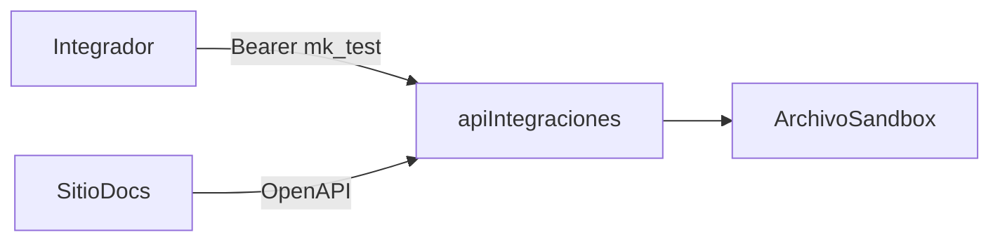

# Sandbox de integraciones Myllos

La primera versión es un ambiente de prueba con el contrato que después usará producción. No llama a [api-delivery-myllos](file:///Users/myllos/Documents/Github/API/api-delivery-myllos), [api-myllos](file:///Users/myllos/Documents/Github/API/api-myllos) ni a DHL, PTX o T1. Así una guía de prueba no recolecta, no cobra saldo real y no genera CFDI.

## API

Nuevo servicio NestJS 10, al estilo de [api-delivery-myllos/package.json](file:///Users/myllos/Documents/Github/API/api-delivery-myllos/package.json), en `/Users/myllos/Documents/Github/API/api-integraciones-myllos`. Puerto local `8095`. Prefijo `/v1`. Swagger en `/docs` y JSON en `/docs-json`.

Autenticación por llave, no por JWT del portal. Header `Authorization: Bearer mk_test_...`. Las llaves válidas viven en `.env` (`SANDBOX_API_KEYS`). Una llave de ejemplo queda documentada para pruebas locales.

Contrato único. El integrador no elige DHL, PTX ni T1:

- `POST /v1/cotizaciones` — CP origen y destino, peso en kg, largo, ancho y alto en cm, contenido. Responde una lista plana con `cotizacion_id`, servicio, precio, días, peso real, peso volumétrico y peso cobrado.
- `POST /v1/guias` — `cotizacion_id`, origen, destino y `Idempotency-Key`. Descuenta el saldo sandbox y devuelve número de guía, costo y saldo.
- `GET /v1/guias/:id` — estado de la guía.
- `GET /v1/guias/:id/etiqueta?formato=pdf|zpl` — PDF 4x6 con marca SANDBOX (`pdf-lib`) o ZPL 4x6.
- `GET /v1/rastreo/:numero` — eventos simulados según la antigüedad de la guía.
- `DELETE /v1/guias/:id` — cancela y reembolsa el costo al saldo si el estado sigue en `documentada`.
- `GET /v1/saldo` — saldo de prepago de la llave.
- `POST /v1/webhooks` — registra una URL para `envio.estado` y `envio.ajuste`.
- `POST /v1/sandbox/guias/:id/simular-ajuste` — dispara un sobrepeso de prueba, descuenta el saldo y llama al webhook.

La cotización acepta recolección, seguro (valor declarado) y acuse. Cada uno suma un cargo fijo de sandbox y viaja en la opción de tarifa. Si el CP de destino está en la lista corta de zonas extendidas, la opción trae `zona_extendida: true` y el cargo correspondiente.

Reglas del simulador, guardadas en un JSON local (`data/sandbox-store.json`) para que sobrevivan un reinicio:

- Peso volumétrico = `(largo * ancho * alto) / 5000`. Peso cobrado = el mayor entre el peso real y el volumétrico, redondeado al entero superior. El sitio la publica como la fórmula de la integración.
- Dos servicios, sin que el integrador elija paquetería: Económico (3 a 5 días hábiles) y Express (1 a 2 días hábiles). Precio determinista por zona y peso.
- Saldo inicial de 5,000 MXN por llave. Sin saldo suficiente responde `402`.
- La cotización vence a los 30 minutos. Una guía generada y no usada se puede cancelar durante 30 días, solo en estado `documentada`.
- La misma `Idempotency-Key` no cobra dos veces.
- Números de guía con prefijo `MYLTEST`.

Errores en un mismo formato: `codigo`, `mensaje`. Pruebas Jest del flujo cotizar, documentar, saldo insuficiente, idempotencia, etiqueta, rastreo, cancelación con reembolso y ajuste con webhook.

Fuera de esta versión: llamar a delivery, business o paqueterías reales, timbrar un CFDI de verdad y abrir una línea de crédito contable. Esos dos últimos se describen en la respuesta comercial como condiciones vigentes de la integración.

## Sitio

Next.js 15 y Tailwind 4 en la carpeta actual, vacía hoy, alineado con [site-myllos/package.json](file:///Users/myllos/Documents/Github/WEB/site-myllos/package.json). Textos en español.

Páginas:

- Inicio: qué es el sandbox y el flujo cotizar, elegir tarifa, crear guía, descargar etiqueta, rastrear.
- Autenticación: header, llave de prueba y errores `401`.
- Sandbox: saldo, vigencia, fórmula de peso, idempotencia y ejemplos `curl`.
- Referencia: Scalar cargando el OpenAPI de `NEXT_PUBLIC_API_URL` (`http://localhost:8095`), con copia estática en `public/openapi.json` por si la API no está corriendo.
- Respuesta a la solicitud: página `/solicitud` que contesta, en el mismo orden, los puntos técnicos y comerciales de la carta del 11 de noviembre de 2026. El tono es el de una propuesta ya operable en sandbox. Lo que hoy no existe en delivery o business se redacta como capacidad de esta integración.

La página de respuesta cubre, con las reglas de arriba:

- Técnica: documentación y base URL, llave `mk_test_dva_sandbox`, webhooks `envio.estado` y `envio.ajuste`, etiqueta PDF y ZPL en 4x6 pulgadas, fórmula `(largo × ancho × alto) / 5000`.
- Comercial: sin mínimo de guías para arrancar; tarifa de lista en sandbox; 5% desde 300 envíos al día y 10% desde 1,000; Económico y Express con cobertura nacional; zona extendida marcada en la cotización; recolección, seguro sobre el valor declarado y acuse, con su cargo; ajustes descontados del saldo y avisados por webhook; prepago operativo y crédito a partir del volumen acordado; CFDI mensual a nombre de DVA; guía vigente 30 días y reembolso íntegro si se cancela en `documentada`; reclamo por daño visible en 24 horas, daño oculto en 7 días y extravío en 30 días, con respuesta en 15 días hábiles; los términos publicados en el sitio son los de la integración.

Esas cifras comerciales son el texto de la propuesta del sandbox. No salen de un contrato firmado ni de las tarifas del portal.

CORS del API permite el origen del sitio en local.